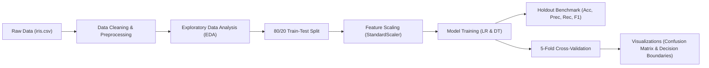

# Multiclass Benchmark Classification Pipeline

An end-to-end supervised machine learning pipeline implemented on the Iris dataset to evaluate, benchmark, and visualize multiclass classification models.

---

## 📌 Project Overview

This project investigates multiclass classification using morphological botanical measurements. The primary objective is to accurately predict the species of an Iris flower among three target classes (**Setosa**, **Versicolor**, and **Virginica**) using two foundational machine learning algorithms:
- **Logistic Regression** (Linear parametric model)
- **Decision Tree Classifier** (Non-linear rule-based model)

The pipeline incorporates robust data preprocessing, exploratory data analysis (EDA), feature scaling, holdout evaluation, 5-fold cross-validation across multiple performance metrics, confusion matrix heatmaps, and 2D decision boundary visualizations.

---

## 📂 Directory Structure

```text
Multiclass_Benchmark_Classification_Pipeline/
├── data/
│   └── iris.csv                 # Dataset file (150 observations, 4 features, 1 target)
├── iris_classification.ipynb    # Main pipeline notebook (EDA, training, evaluation, plots)
└── README.md                    # Project documentation
```

---

## 📊 Dataset Description

The Iris flower dataset consists of 150 instances categorized evenly across 3 classes (50 instances per class). After data cleaning, one exact duplicate row is dropped, leaving 149 samples.

| Feature Name | Type | Description |
| :--- | :--- | :--- |
| `sepal_length` | Continuous (`float64`) | Length of the sepal in centimeters |
| `sepal_width` | Continuous (`float64`) | Width of the sepal in centimeters |
| `petal_length` | Continuous (`float64`) | Length of the petal in centimeters |
| `petal_width` | Continuous (`float64`) | Width of the petal in centimeters |
| `species` | Categorical (`object`) | Target class: `setosa`, `versicolor`, `virginica` |

---

## ⚙️ Technical Workflow & Pipeline Architecture



### 1. Data Cleaning & Inspection
- Verified data types and confirmed **zero missing/null values**.
- Detected and removed **1 duplicate row**.

### 2. Exploratory Data Analysis (EDA)
- **Class Distribution:** Balanced representation across all three flower species.
- **Feature Distribution & Boxplots:** Evaluated skewness, spread, and checked for outliers.
- **Correlation Heatmap:** Observed strong positive linear correlation between `petal_length` and `petal_width` ($r > 0.96$).
- **Pairwise Relationships:** Highlighted that *Setosa* is completely linearly separable from *Versicolor* and *Virginica*, whereas the latter two have slight overlap in boundary regions.

### 3. Data Splitting & Feature Scaling
- **Train/Test Split:** 80% training ($n = 119$), 20% testing ($n = 30$) with fixed random seed (`random_state=42`).
- **Feature Standardization:** Applied `StandardScaler` to normalize features ($\mu = 0, \sigma = 1$), fitting strictly on training data to prevent data leakage.

### 4. Model Training & Cross-Validation
- **Logistic Regression:** Multinomial classification with `max_iter=200`.
- **Decision Tree Classifier:** Gini impurity criterion with `random_state=42`.
- **Cross-Validation:** 5-fold stratified cross-validation computing weighted Accuracy, Precision, Recall, and F1-score.

---

## 📈 Benchmark Results

### 1. Holdout Test Set Performance (80/20 Split)

| Algorithm | Accuracy | Precision (Weighted) | Recall (Weighted) | F1-Score (Weighted) |
| :--- | :---: | :---: | :---: | :---: |
| **Logistic Regression** | **1.0000** | **1.0000** | **1.0000** | **1.0000** |
| **Decision Tree Classifier** | **1.0000** | **1.0000** | **1.0000** | **1.0000** |

*Both models achieved 100% accuracy on the 30-sample holdout test partition.*

### 2. 5-Fold Stratified Cross-Validation Benchmark

To obtain an unbiased assessment of generalization capability and avoid single-split variance:

| Metric | Logistic Regression (Mean ± Std) | Decision Tree Classifier (Mean ± Std) |
| :--- | :---: | :---: |
| **Accuracy** | **94.96% ± 6.12%** | 92.43% ± 3.14% |
| **Precision (Weighted)** | **95.68% ± 5.37%** | 93.30% ± 3.03% |
| **Recall (Weighted)** | **94.96% ± 6.12%** | 92.43% ± 3.14% |
| **F1-Score (Weighted)** | **94.88% ± 6.27%** | 92.36% ± 3.22% |

---

## 🎨 Visualizations

The pipeline produces:
1. **Confusion Matrix Heatmaps:** Evaluates true vs. predicted labels for both the holdout test set and aggregated out-of-fold predictions (`cross_val_predict`).
2. **2D Decision Boundaries:** Evaluates decision surfaces using the two most discriminative features (`petal_length` and `petal_width`):
   - **Logistic Regression:** Displays smooth, linear boundaries with wide margins.
   - **Decision Tree:** Displays rectangular, axis-parallel partition boundaries.
   - **Cross-Validated Decision Boundary:** Evaluates the decision surfaces generated by the highest-performing fold estimators (`return_estimator=True`).

---

## 🏆 Key Takeaways & Conclusions

- **Champion Model:** **Logistic Regression** is the preferred model, offering superior generalization accuracy (**94.96%** vs. **92.43%**) across 5-fold cross-validation.
- **Overfitting Resistance:** While the Decision Tree achieves high holdout accuracy, its orthogonal partition boundaries tend to over-partition localized sample noise compared to the regularized linear hyperplanes of Logistic Regression.
- **Key Determinant Features:** Petal dimensions (`petal_length` and `petal_width`) provide the strongest predictive signal for Iris flower classification.

---

## 🚀 How to Run

### 1. Clone the repository and navigate to the project directory
```bash
cd Multiclass_Benchmark_Classification_Pipeline
```

### 2. Install dependencies
From the project root:
```bash
pip install -r ../requirements.txt
```

### 3. Launch the Jupyter Notebook
```bash
jupyter notebook iris_classification.ipynb
```
Select **Run All Cells** to execute the pipeline end-to-end.

